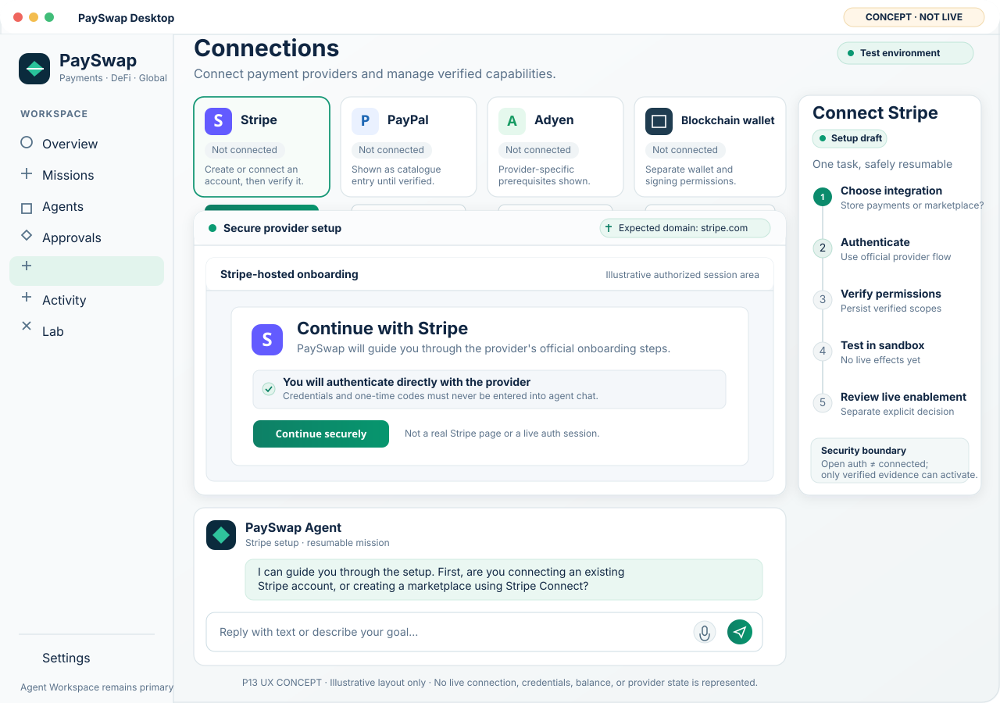
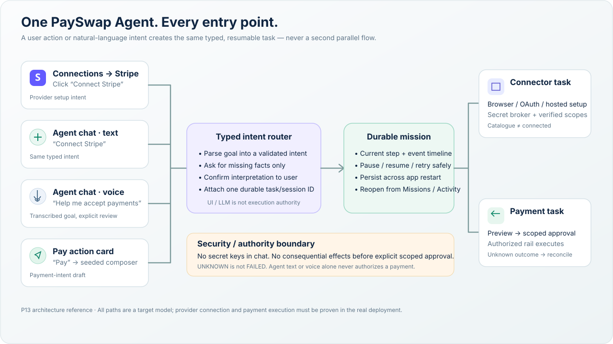

# P13 UX reference — agent-led connectors and payment missions

**Status:** target UX and implementation contract; not evidence of shipped functionality.
**Authority:** [P13 issue #3](https://github.com/payswapdotorg/PaySwap-3.0/issues/3), with the desktop/platform release-blocking work tracked separately in [P12 issue #2](https://github.com/payswapdotorg/PaySwap-3.0/issues/2).
**Companion graphics:** source-controlled SVG concepts in this folder. They are design aids—not screenshots of the currently shipped application and not proof of Stripe connectivity or payment dispatch.

## Visual references

### Connections → Stripe

The Connections surface selects a provider and creates a resumable onboarding task. A provider session may be rendered inside an isolated integrated browser when supported; otherwise the system browser is used with validated return/resume handling. A provider page must be visually identified by origin and authorization context. Never mimic the provider in a way that could make credentials appear to be entered into PaySwap.

The concept deliberately avoids showing synthetic balances, connected badges, transactions, fake provider dashboards, or success banners. The illustrated “continue securely” content is only a placeholder for the real provider flow.

### Shared entry points

The Connections Connect button, a natural-language request such as “connect Stripe”, voice input, and Pay must converge on the same typed-intent/task orchestration. They may seed different intent types, but must share identity, progress, session history, pause/resume, error recovery, and evidence.

### Pay → conversation → long-running task

Pay opens the shared composer with the Pay intent prefilled. The agent fills only missing facts and produces a structured draft that the user can inspect. A typed intent or a recognized voice transcript does not authorize financial effects. Dispatch follows validation, preview, and explicit scoped authorization.

## Required journeys

1. **Connections → Stripe:** choose integration type (own-store payment acceptance, existing account connection, or marketplace/Stripe Connect), review purpose and requested permissions, enter provider-controlled authentication, resume from redirect, verify persisted connection and scopes, run safe test-mode verification.
2. **Agent → “connect Stripe”:** open the existing shared agent composer, type/speak the intent, parse to the same connector task ID and flow as Journey 1.
3. **Interrupted onboarding:** keep durable draft and task history while switching windows or restarting; validate redirect correlation/state and provider identity on return; expired, revoked, cancelled and uncertain states are explicit and retry safely.
4. **Other PSPs:** same generic task framework; provider adapters declare auth mechanism, required scopes, account model, test/live support, verification probe, webhook needs, revocation and retry rules. Do not assume all PSPs offer the same flow.
5. **Add PaySwap to a store:** identify store/framework and desired use case; select only actually supported API/SDK/hosted-checkout mechanisms; provision sandbox credentials through host-side secret handling; configure and verify required webhooks; independently gate production.
6. **Connect blockchain:** establish wallet/account and network through supported wallet-connect/signing flows; never ask for recovery phrases or private keys in chat; display only externally observed facts with provenance and freshness; wallet connection does not equal transaction-signing or execution authority.
7. **Pay by text or voice:** capture amount/currency, payer/source, recipient/destination, country/corridor, deadline, cost limit, purpose, privacy/compliance constraints, and supported partial-payment preferences. Ask for missing or ambiguous fields instead of guessing.
8. **Review and authorize:** validate supported routes, observed capability, balance observations when truly available, quote freshness, fees/provenance, limits and required approvals. Present exact structured preview. A separate explicit user authorization is required for consequential dispatch.
9. **Long-running mission and reconciliation:** persist mission/task ID, stage, events, idempotency/correlation IDs and evidence. Remain usable during execution. Resume after restart. Treat timeouts and ambiguous external outcomes as UNKNOWN / needs reconciliation; never silently rewrite UNKNOWN to FAILED or success and never blindly repeat an ambiguous write.

## Security and honest-state requirements

- Agent, LLM, browser content, intent router and UI are not payment authority.
- Never put secret API keys, OAuth tokens, webhook signing secrets, passwords, one-time codes, card security codes, seed phrases, or private keys into chat transcripts, model context, screenshots, logs, browser snapshots or analytics.
- Prefer provider-supported OAuth/hosted onboarding over manual secret entry. If credentials must be supplied, use a host-side secure credential broker/native secret field, least privilege, masking, and non-returnable handles—not chat.
- Separate sandbox and live credentials, states, webhooks and evidence mechanically.
- “Browser opened”, “form submitted” or “redirect returned” is not a connected provider. “Wallet connected” is not signing authority. “Payment request accepted” is not final settlement.
- Catalogue entry ≠ connected instance. Live verification must rely on persisted server/provider evidence.
- Unknown outcome ≠ failed outcome; reconcile before retrying a potentially consequential operation.

## Implementation source of truth

The implementation handoff is [P13 issue #3](https://github.com/payswapdotorg/PaySwap-3.0/issues/3). The current capability survey is [FEATURE-MAP.md](../../spec/productization/FEATURE-MAP.md); the journey contract is [JOURNEY-MAP.md](../../spec/productization/JOURNEY-MAP.md). Update both from code-backed evidence as implementation advances.

The current FEATURE-MAP has described provider Connect/authenticate as UNAVAILABLE because the app-level provider connection plane is not yet wired in this deployment. Do not flip it to WIRED based on these design artifacts, a catalogue card, or a contract-only test. Add E2E evidence for the real sandbox flow first, then accurately mark any live flow separately.

## Inputs from the operator

The operator supplied two reference screenshots in the original conversation:
- **Target/concept:** PaySwap Agent Workspace with outcome-first overview; Pay / Receive / Move / Convert entry actions and a visible disclaimer that the image is conceptual.
- **Current app:** ZCode-derived dark desktop interface, whose original agent composer and developer affordances need to be integrated into PaySwap’s coherent UX.

The repository graphics here are re-drawn design references derived from that desired direction and the P13 UX requirements. They do not claim to be the exact supplied files or actual application screenshots. The local packaged app must be captured separately at acceptance time and clearly identified by commit/build/version.

## Review checklist for the TL

- [ ] Both Connections and composer entry reach the same connector task and resume state.
- [ ] Provider-specific auth runs in an isolated trusted context and return handling is validated.
- [ ] Real Stripe test-mode account/scopes are persisted and independently verified; no fabricated ACTIVE state.
- [ ] Shared composer supports text and supported voice input without bypassing review/authorization gates.
- [ ] Pay button and natural-language Pay use one typed intent path.
- [ ] Payment task is durable, resumable and non-blocking; ambiguous outcomes are reconciled.
- [ ] Other PSP, PaySwap API/store, and onchain variations reuse the orchestration framework without conflating their security models.
- [ ] Shipped screenshots and test receipts are from the exact candidate build and are distinguished from these concepts.
